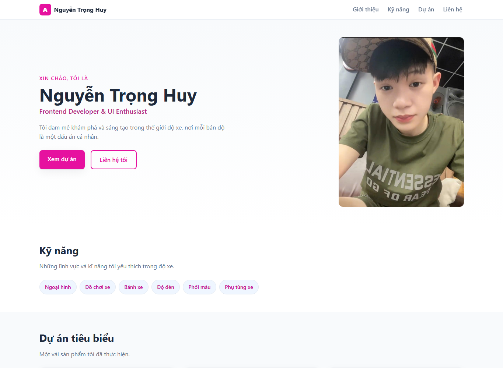

# Báo cáo kiểm thử

**Dự án:** Portfolio CV - Nguyễn Trọng Huy  
**Phiên bản:** v1.0  
**Ngày kiểm thử:** 27/10/2026  
**Phạm vi:** Kiểm tra trang tĩnh `index.html` và CSS trên trình duyệt Microsoft Edge; không bao gồm kiểm thử xâm nhập hoặc kiểm thử triển khai production.

## Kết quả tổng quan

| Tiêu chí | Kết quả | Minh chứng và ghi chú |
|---|---|---|
| Tính đúng đắn | Đạt một phần | Trang hiển thị các khu vực chính và toàn bộ 5/5 ảnh tải thành công. Còn 3 liên kết “Xem chi tiết” trỏ đến `#`, tiêu đề tab ghi “Nguyễn Văn An” thay vì “Nguyễn Trọng Huy”, và một mục tag trong thẻ dự án đang để trống. |
| UI/UX | Đạt | Đã kiểm tra tại độ rộng 360, 390, 767, 768, 1279 và 1280 px. Không phát hiện tràn ngang; lưới dự án lần lượt hiển thị 1 cột dưới 768 px, 2 cột từ 768 px và 3 cột từ 1280 px. Xem ảnh chụp màn hình bên dưới. |
| Khả năng vận hành - xử lý lỗi | Đạt một phần | Trang mở và hiển thị được dưới dạng tệp cục bộ trong Edge; các ảnh cục bộ đều tải thành công. Vì đây là website tĩnh không có backend, biểu mẫu hay JavaScript nên không có luồng xử lý lỗi ứng dụng để kiểm thử. Chưa xác minh cách máy chủ xử lý lỗi khi thiếu tệp hoặc khi triển khai thực tế. |
| Bảo mật | Đạt trong phạm vi kiểm tra tĩnh | Không thấy mã JavaScript, biểu mẫu thu thập dữ liệu, backend hoặc thư viện bên thứ ba trong trang được kiểm tra. Trang có các liên kết điều hướng ra ngoài; chưa đánh giá cấu hình HTTPS, header bảo mật của máy chủ hoặc thực hiện kiểm thử xâm nhập. |
| Chất lượng mã nguồn | Đạt một phần | Cấu trúc HTML có các vùng điều hướng, nội dung chính và footer; ảnh có văn bản thay thế; CSS sử dụng biến, Flexbox, Grid và media query. Cần đồng nhất tiêu đề tab với tên hiển thị và loại bỏ tag rỗng. Không có bộ kiểm thử tự động hoặc linter trong dự án để chạy. |
| Khả năng triển khai | Đạt một phần | Website tĩnh, không cần cài dependency hoặc biên dịch; có thể mở trực tiếp bằng trình duyệt. README đã hướng dẫn chạy cục bộ và bằng Docker/Nginx, nhưng chưa chạy thử máy chủ hoặc Docker trong môi trường kiểm thử này (Docker CLI không được cài đặt). |

## Minh chứng hình ảnh

Ảnh được chụp trực tiếp từ trang chạy trong Microsoft Edge và lưu trong `docs/screenshots/`.

### Giao diện máy tính (1365 × 1000)

### Giao diện điện thoại (390 × 1000)

## Ghi chú kiểm thử

- Các phép kiểm tra responsive được thực hiện trên các độ rộng viewport 360, 390, 767, 768, 1279 và 1280 px.
- Kiểm tra tải ảnh xác nhận 5/5 ảnh trong trang đã tải thành công trên trình duyệt.
- Kết quả này phản ánh phiên bản mã nguồn tại ngày kiểm thử; cần kiểm tra lại sau khi thay đổi nội dung, CSS hoặc cấu hình máy chủ.